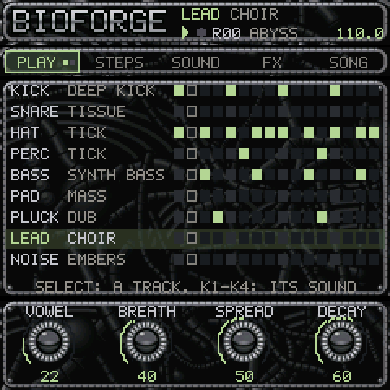
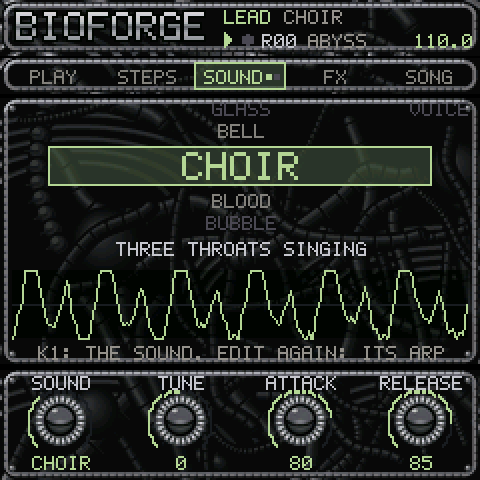
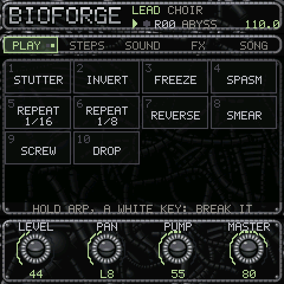
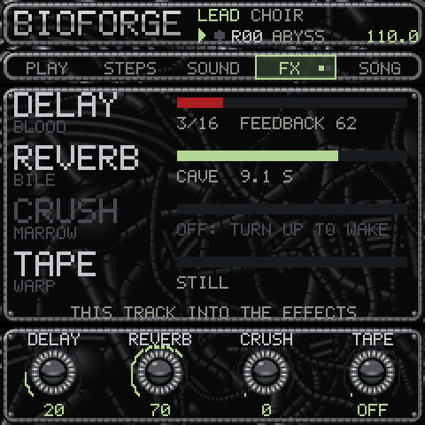
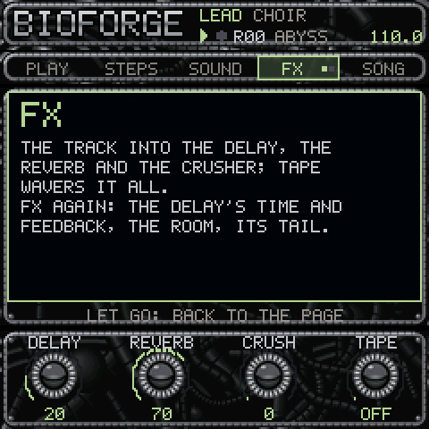
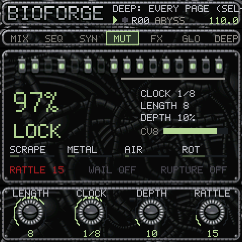

# BIOFORGE for the M-VAVE FM-1

**A biomechanical sci-fi dungeon synth and groovebox that sounds like its own disturbing machinery.** Pipe organs,
string machines, choirs and harpsichords in cathedral rooms; the brass and sequences of old science fiction; rhythm from
pressure, fracture, friction and vents in resonant bodies. Tonal organs add mass, breath, nerve discharges and an
artificial throat. You play the keys straight into the pattern memory. A Turing register works as a nervous system:
it locks the sound and the rhythm in place, and changes them slowly.

<p align="center">
  <a href="https://joakimskurk.github.io/fm1bioforge/"><b>The page: play BIOFORGE in the browser, hear the demos, install it from there →</b></a>
</p>

<p align="center">



</p>

> [!CAUTION]
> **Early alpha: not yet tried on a real FM-1.** Its sounds, its controls and the way it keeps its scenes still change
> (a new version can forget what an older one saved). It is built and tested on every change: the host tests,
> Dinghy's platform tests, the FM-1 and SMK-37 packages with the chip's own checks, and a run in fm1-emu (the FM-1
> emulator) in CI. It has not been tried on an actual device yet. Install it at your own risk.

This is a [Dinghy 0.5](https://github.com/zvenson/dinghy) app. It comes from an idea document,
*BIOFORGE idédokument v3.0*, fitted to the FM-1: 27 keys, 14 buttons, 7 encoders, two cores without an FPU and a
240 x 240 screen. [docs/bioforge/PLAN.md](docs/bioforge/PLAN.md) says what was kept and how it was fitted.
[DECISIONS.md](docs/bioforge/DECISIONS.md) says why.

## A groove in one minute

1. **Press PLAY.** ABYSS plays: a deep kick, crackle, dub chords, a choir in a cave.
2. **Turn SELECT** to a track: KICK, SNARE, HAT, PERC, BASS, PAD, PLUCK, LEAD or NOISE. It lights up.
3. **Turn K1–K4.** They are always that track's four most important sounds, named as its sound has them: a CHOIR's
   VOWEL, BREATH, SPREAD and DECAY; a kick's PITCH, SWEEP, FALL and DECAY.
4. **Play the keys.** They play the track. Press **REC** and what you play goes into it, in time; REC again: it loops.
5. **Turn ALGORITHM: MUTATE.** At 0 the music repeats as it is. Turn it up and it starts to change by itself, step
   by step. Turn it back to 0 and what it has become stays.
6. **Turn PRESETS** to the next scene: RUST, THE AWAKENING, ASH. It changes on the one.
7. **Hold any button** to see what it does. **SAVE** keeps the scene.

## Three ideas

- **Nine tracks, four knobs.** Every track is one voice and its pattern. Whatever page you are on, SELECT picks the
  track and K1–K4 turn it.
- **Five pages, one a button.** HOME is PLAY, SEQ is STEPS, EDIT is SOUND, FX is FX, GLO is SONG. Press the button
  again for its second page; it never goes deeper. The page you are on is lit at the top, its two dots say which of
  its two pages.
- **The music changes by itself, if you let it.** A Turing register (after the Music Thing Modular Turing Machine)
  runs under everything. MUTATE says how much it changes the noise, the notes and the rhythm; at 0 it is a locked loop.

## The cheat sheet

| | |
|---|---|
| **SELECT** | The track: DRUMS (the kit on the keys, four zones), KICK, SNARE, HAT, PERC, BASS, PAD, PLUCK, LEAD, NOISE |
| **ALGORITHM** | MUTATE: how much the music changes by itself (0: locked) |
| **PRESETS** | The scene, R00..R03 (playing: on the one). **SEL +** PRESETS: one of thirty factory scenes into it |
| **K1–K4** | The page's four, for the track |
| **HOME** | **PLAY**: the nine tracks and their steps; K1–K4 the track's four (DRUMS: the four drums' levels). Again: **MIX**: LEVEL, PAN, PUMP, MASTER |
| **SEQ** | **STEPS**: STEP, LENGTH, VELOCITY, CHANCE. Again: STEPS (the track's length), REPEAT, NUDGE, NOTE |
| **EDIT** (or ENV) | **SOUND**: SOUND (a list, each with a line on what it is), TUNE, ATTACK, RELEASE. Again: its ARP (ARP, RATE, RANGE, CHORD); a drum: what it is made of |
| **FX** | The track into DELAY, REVERB, CRUSH; TAPE wavers it all. Again: the delay's TIME and FEEDBACK, the reverb's ROOM and TAIL |
| **GLO** | **SONG**: TEMPO, SWING, KEY, SCALE. Again: the chain: this scene's BARS, THEN which scene |
| **ARP** | Tap: the track's ARP. **Hold**: break it on the white keys: STUTTER, INVERT, FREEZE, SPASM, REPEAT 1/16, REPEAT 1/8, REVERSE, SMEAR, SCREW, DROP |
| **HOME** held | White keys 1–9 mute the tracks, 10 the drums together |
| **SEQ** held | The white keys are the track's 16 steps: tap to set or clear; hold one and turn K1–K4 for a lock on that step; OCT−/+ the next 16 |
| **LFO** | Tap: MUTATE and the register. **Hold**: WRITE 0, WRITE 1, RESET, FUSE, LOCK |
| **PLAY / REC** | Start, stop. REC: playing, record; stopped, STEP REC (K1 the step) |
| **SEL +** | OCT− UNDO, OCT+ REDO, PLAY PANIC, REC OVERDUB/REPLACE, SAVE every scene, a key while recording ERASE, **EDIT: DEEP** |
| **SAVE** | The scene to flash, when it is quiet. Left alone, stopped, it saves itself |

**DEEP** (SEL + EDIT; again to come back) wakes every page of before: MIX, SEQ, SYN, MUT, FX and GLO, each with
SHIFT's second row; ALGORITHM is the register's LOOP again (100 % locked, 0 % double-locked).

## Where is …?

| | |
|---|---|
| A synth's MODEL, a drum's SOUND | SOUND, K1: one list (ORGAN, STRINGS, CHOIR, BELL, DUB, …; TICK, CLAP, DEEP KICK, …) |
| BODY, TEXTURE, MOTION, DECAY | PLAY's K1–K4, under the names the sound gives them |
| The sends | FX: the track's DELAY, REVERB, CRUSH. An effect that is off wakes when you send to it |
| The reverb's SPACE (CATHEDRAL …) | FX again: ROOM |
| WARP | FX: TAPE |
| LOOP | ALGORITHM: MUTATE (DEEP: LOOP) |
| The mutes | HOME held: the white keys |
| BURST and SCAR | ARP held: the white keys |
| SONG | GLO again: BARS, THEN |
| KEY, SCALE | GLO: SONG, K3 and K4 |
| The ARP | ARP tapped, or EDIT again |
| HEART, BONE, TEETH, CLAW, DRONE, SPASM, VOICE | The tracks KICK, SNARE, HAT, PERC, PAD, PLUCK, LEAD: the organs' own names are on SOUND, in grey |
| The deep parameters, the envelope's DECAY and SUSTAIN, RATTLE, WAIL, RUPTURE, SCATTER, RUMBLE, DARK, QUANTISE, the MIDI channel | DEEP (SEL + EDIT) |

## What it does

- **Nine tracks, nine organs, six channels.** KICK, SNARE, HAT and PERC are the drum organs HEART, BONE, TEETH and
  CLAW, on the DRUMS channel; BASS, PAD, PLUCK, LEAD and NOISE are BASS, DRONE, SPASM, VOICE and NOISE. Each track
  can be any of its kind's sounds. Everything you hear is synthesised in integers: no samples.
- **TISSUE drums.** A drum organ is not a kick, snare or hat with distortion. Each hit is an excitation: a PRESSURE
  impulse, seeded FRACTURE clicks, coloured FRICTION noise and a VENT of air. It runs through damped modal resonators
  at the idea document's frequencies, then an asymmetric flesh curve.
  - **HEART** (KICK) is a hydraulic piston in a wet body, with modes at 93, 171 and 286 Hz.
  - **BONE** (SNARE) is a brittle fracture whose resonance bends after the blow.
  - **TEETH** (HAT) is a ratchet of metal teeth. The lower keys play it closed, the upper keys open.
  - **CLAW** (PERC) is a gesture dragged through ribs, as long as you hold the key.
  - A shared **rib** resonator ties the four together.
- **Rhythm made of noise.** NOISE is a noise voice, and any drum can become one (SOUND, K1). The sequencer locks each step's noise, so the same noise comes back pass after pass and is the groove; the
  Turing's LOOP lets it slip, step by step. **SCATTER** gives every step its own slice of it (band, length, shape,
  place), **TONE** puts the band on the note (riffs of hiss, a second band a fifth up), **DRIFT** steps the band bar
  by bar, and a noise step's ratchet repeats its own noise: a stutter (DEEP: SYN, SHIFT).
  - **The voice**: a source (WHITE, PINK, DIGI and METAL shift-register noise, and four organic crackles: DUST, FIRE
    in clusters over a smoulder, FRY a sizzle, CREAK a gliding stick-slip), grain, a resonant filter
    that morphs low-pass, band-pass and high-pass and pings at high resonance, a sweep (a zap down, a rise up), bursts
    (a clap), a click, an envelope that strikes or is held while the key is, drive, a crusher and stereo width.
  - **Twenty-two sounds to start from**: TICK, HISS, METAL, DIGI SNR, CLAP, ZAP, RISE, CRUSH, CRACKLE, GRAIN, PING,
    THUMP, WASH, FLAM SNR, BIT HAT, LASER, and the crackles EMBERS, SPARKS, SIZZLE, GREASE, CREAK, HINGE. SOUND (EDIT, K1) gives one to a track; TISSUE gives
    a drum its own body back.
- **Landscapes for the synths.** SOUND (EDIT, K1) makes BASS, PAD, PLUCK or LEAD one of sixteen other
  voices: **industry** HUM (the mains, with sparks), STEEL (bowed metal), PISTON (a machine stroking on the beat while
  the key is held); **cosmic** GLASS (inharmonic partials beating, rough with phase modulation and a detuned twin), BELL (dirty FM: two
  carriers apart, the modulator fed back on itself, a floor of grit, driven), CHOIR (three throats through vowels);
  **the body** BLOOD (a pulse with the beat), BUBBLE (rising drops), SLIME (a wet squelch).
- **Rooms.** The reverb's ROOM (FX again, K3): HALL, ROOM, CAVE, METAL (a ringing tank), VAST or CATHEDRAL (as big as
  VAST, three times as long, darker, its walls far).
- **A deep kick.** A drum organ's MODEL KICK: a sine swept down to its pitch, held, a long decay, drive, then low-passed
  so it keeps almost no top. DEEP KICK, SUB KICK, DUB KICK, PUNCH KICK and WAR DRUM on SOUND.
- **PUMP and RUMBLE.** PUMP: the kick ducks the other channels and the delay's and reverb's returns, back by the next
  eighth (PLAY again: MIX, K3). RUMBLE (DEEP): the kick's own dark low tail, breathing with it.
- **DUB** chords: a synth's MODEL DUB, a minor chord through a low-pass that each note opens, for the delay.
- **The drone's body.** MASS (octaves and a fifth) and CLUSTER (semitones): thick drones under a breathing low-pass,
  with grit and their own width. **DARK** (DEEP) rolls the whole top off.
- **The dungeon and the stars** (D39): ORGAN (a pipe organ, its ranks drawn in by TEXTURE, a chiff, the tremulant),
  STRINGS (a string machine with its ensemble), BRASS (a big polysynth's brass that swells open, the vibrato growing
  in), HARPSI (a plucked string, harpsichord to lute).
- **Four macros a track**, BODY, TEXTURE, MOTION and DECAY, named by what they do in its sound (PLAY's K1–K4). The
  depth is behind them, in DEEP.
- **The keys go into the memory.**
  - **LIVE REC**: press PLAY, then REC, and play.
  - **STEP REC**: stopped, press REC; each key writes a note at the cursor.
  - **PARAM REC**: while recording, turning a macro writes a p-lock.
  - Recording overdubs, or replaces (SEL + REC). Hold SEL on a key to erase that note.
  - SEL + OCT−/OCT+ undo and redo, 16 levels.
  - Quantise is non-destructive: a live note keeps the moment you played it, and the track's quantise places it
    when it plays.
- **The nervous system.** A 16-bit shift register, clocked from the transport. **ALGORITHM is MUTATE on every
  page**: at 0 it is locked and repeats every LENGTH clocks; turned up, it slips more and more; at 100 it is random.
  (DEEP shows its LOOP, as the Turing Machine has it: 100 % locked, 0 % double-locked: the pattern, then its
  inverse; between, it slips.)
  - It moves the texture, CLAW's scrape, TEETH's metal and HEART's air (ROT and the routes).
  - It adds ghost hits on TEETH and CLAW (RATTLE) and can pick SPASM's and VOICE's notes from D Phrygian (WAIL).
  - It never moves or deletes what you played. FUSE writes its ghosts into the pattern, if you ask for it.
- **Effects.** DELAY (BLOOD: synced, darker on each echo, ping-pong), REVERB (BILE: four modulated delay lines, a
  FREEZE) and CRUSH (MARROW: a parallel drive, sample-rate and bit crusher). Each channel has its own sends.
- **SCAR** keeps the last 0.37 s of what comes out, in stereo, and plays it back while you hold a BURST key: REPEAT 1/16
  and 1/8 (on the grid, darker each time round), REVERSE (the 8th just played, backwards), SMEAR (the buffer frozen,
  grains crossing in it), SCREW (the 8th just played at half speed, an octave down) and DROP (a cut to silence). The
  music goes on underneath, in time, for when you let go.
- **TAPE** (FX, K4; WARP in DEEP) puts everything through a short tape whose speed wavers: a slow wow, a flutter, a
  drift. **RUPTURE** (DEEP: MUT, its second page) lets the register cut into the music itself: silences, stutters,
  reversals, a bar screwed down; locked, the cuts come back where they were, a structure of their own.
- **Four scenes in RAM**, each its own world at first:
  - R00 ABYSS, dark ambient meets noise, 110 BPM: a deep kick and its rumble, crackle and the room breathing with it,
    wide dub chords, a choir;
  - R01 RUST, grim dark industrial ambience with a pulse and a melody: a drone for a body, a smouldering rumble, a sub
    kick, dark noise locked in 16ths, a bell the register plays;
  - R02 THE AWAKENING, the idea document's start scene;
  - R03 ASH, its ambient side: a sub kick, a big rumble, fire and creaking wood, glass and a choir in a vast space.
  - PRESETS switches between them on the next bar. **SEL + PRESETS loads a factory scene** into the one that
    plays: those four, FROZEN (slices of noise locked into a groove), STREAM (one noise, gated), WALL (a riff of pitched noise), DATA (clicks, bursts, digital noise,
    stutters), EMBERS (crackle), FOUNDRY (industry), ORBIT (cosmic), INNARDS (the body), STATIC CULT (noise as
    percussion, with PUMP),
    SPLICE (broken, glitched), VOID (slow and wide), LAMENT (a melody, C harmonic minor), GRINDER (industrial techno,
    140 BPM, the hard end), SPINE (a half-time broken beat, 170 BPM), OSSUARY (no beat at all, C# Locrian), TENDON
    (seven eighths), SHRINE (sweetness, ruptured: E Lydian through a wavering tape, the register cutting into it), MIRAGE
    (a loop chopped and screwed by the register), CRYPT (dungeon synth: an organ, strings, a harpsichord, D harmonic
    minor), STARGATE (sci-fi, Berlin school: a brass lead over a bass sequence), CATACOMB (a choir singing chords, a
    strummed harpsichord, a cathedral), ORACLE (sci-fi: a choir pad, brass stabs, a bass arpeggio), THE CRYPT SUITE's
    three more bodies of CRYPT's theme (CRYPT:IRON industrial, CRYPT:STAR science fiction in double time, CRYPT:NAVE a
    cathedral with no beat: load them into the four scenes and chain them with SONG) and EMPTY BODY. The one in flash stays until you SAVE.
  - Each scene is saved in two flash slots, so a save cut off by a power cut leaves the last good one.

## DEEP: every page

SEL + EDIT wakes the pages of before, for everything SIMPLE leaves out; SEL + EDIT again goes back. Here SEL held
is SHIFT, and a tap keeps the knobs' second row.


| Control | What it does |
|---|---|
| **ALGORITHM** | The Turing's LOOP, from chaos to lock, on every page. |
| **KNOB 1..4** | The page's four parameters (SHIFT: the second four). |
| **HOME** | MIX: the six channels' levels; again: the focused channel's sends. **Held:** the mutes, as in SIMPLE. |
| **SEQ** | SEQ: the grid. **Held:** the white keys are the focused track's 16 steps: tap to set or clear; hold one and turn a knob for a p-lock; OCT± for the next 16. |
| **EDIT** | SYN: BODY TEXTURE MOTION DECAY (SHIFT: a noise organ's SCATTER TONE DRIFT, a synth's MODEL); again: the organ's own depth. |
| **ENV** | The organ's envelope (drums: the gesture, tune, level, pan; SHIFT: SOUND, and a noise sound's GATE, WIDTH, RELEASE). |
| **LFO** | MUT: the spine. **Held:** white keys WRITE 0, WRITE 1, RESET, FUSE, LOCK. |
| **FX** | Delay, reverb, crush; again: their times and colours; again: the reverb's SPACE. |
| **GLO** | Tempo, swing, quantise and its strength; SHIFT: OVERDUB or REPLACE, the step length, the key LEDs, the MIDI channel. |
| **GLO** again | The notes: KEY (D .. C#: the synths and NOISE move to it, the drums stay) and SCALE (PHRYGIAN, AEOLIAN, LOCRIAN, HARM MINOR, PHRYG DOM, WHOLE TONE, PENTA MIN, CHROMATIC, LYDIAN, MAJOR, DORIAN, HIRAJOSHI: WAIL and the ARP pick from it); the focused synth's ARP (UP, DOWN, UP-DN, NERVE: the register picks; CHORD: the whole chord at once, on ORGAN, STRINGS, BRASS, CHOIR and HARPSI, which strums it) and its RATE; SHIFT: its RANGE (1 to 3 octaves; CHORD: 2 and 3 open), CHORD (TRIAD, 7TH, 9TH, SUS4, FIFTHS), GATE. |
| **GLO** again | SONG: each of the four scenes plays its BARS (1 .. 64; OFF: for ever), THEN the scene after it, so the scenes chain into a piece; PRESETS still asks for another, which wins. |
| **ARP** | **Held:** BURST on the white keys: STUTTER, INVERT (the register), FREEZE (the reverb), SPASM (a nerve burst); SCAR on keys 5 to 10: REPEAT 1/16, REPEAT 1/8, REVERSE, SMEAR, SCREW, DROP (the last pressed plays). |
| **SELECT, PRESETS, SAVE, PLAY, REC, OCT** | As in SIMPLE. |
| **MIDI in** | Notes on channel 1 go to the track, channels 2–10 to KICK … NOISE; they record as the keys do. Start and stop follow. |

**From nothing to a loop.** SEL + PRESETS back one: EMPTY BODY. Turn SELECT to BASS. Press PLAY, then REC, and play
four notes over a bar. Press REC again: the phrase loops. Turn SELECT to HAT and play metal hits on the keys. Turn
K2 on PLAY and MUTATE (ALGORITHM) until the phrase is right, then MUTATE back to 0: locked. Press SAVE.

**Correcting a step.** Press PLAY to stop, select BASS, press REC (STEP REC: the STEPS page). Turn K1 to step 7 and
play E♭1; it goes in with the step length and the cursor moves on. Turn K1 back to it: K2 sets its length. Press PLAY: it plays with
the drums, and the live notes keep their timing, because quantise only places them.

**The kit** (SELECT on DRUMS): four zones of about seven keys each. KICK is F3–B3, SNARE C4–F#4, HAT G4–C#5 and PERC
D5–G5. The middle key of each zone, which glows, plays the organ as it is set; the others tune its body up or down.

<p align="center">



</p>

## Install and try

**Try it without an FM-1:** *Play it here* on [the page](https://joakimskurk.github.io/fm1bioforge/#play), in any
recent browser, phones too: the firmware itself compiled to WebAssembly, its sound, its screen and its keys' lights.
The page also has eight demos, each the firmware played by a script (`tests/scripts/demo_*.txt`; there are more).

**Install it from the browser:** [the page's installer](https://joakimskurk.github.io/fm1bioforge/#install), in Chrome
or Edge on a computer, the FM-1 on USB. It always offers the latest build of `main` that passed its tests.

**Or install it** from a computer with Python, the FM-1 on USB:

```sh
python3 tools/fm1_install.py build/bioforge.fwsc     # asks before it writes, then restarts into BIOFORGE
```

If anything goes wrong, hold **OCT−** while switching the FM-1 on. It starts in the USB rescue, where an installer
always works. Installing firmware is at your own risk.

**Build and test:**

```sh
make test     # the engine's and the memory's tests (plain and ASan/UBSan), the renders: build/audio/*.wav and their spectrograms
make host     # the app on a computer: a tour of its pages, build/host/bioforge.wav and screenshots
sh tools/readme_screens.sh   # docs/screens/*.png, the README's and the page's
make perf     # the engine's instructions a frame (callgrind): the awakening, and everything at once
make fw       # the FM-1 and SMK-37 packages (the JieLi toolchain and the AC79 SDK: docs/DINGHY_README.md)
make web      # the page: the demos, BIOFORGE for the browser (clang, lld), its check in Node, build/site/ (ffmpeg)
```

## How it is made

- **[The plan](docs/bioforge/PLAN.md)** covers the organs with the idea document's numbers, the sequencer and its
  recording, the nervous system, the screens, what is cut or comes later, and the budget.
- **The engine** is `firmware/src/bio_dsp.h`, `bio_organs.h` and `bio_engine.h`. It uses integers only, the
  magic-circle modes, TPT filters, the effects at half rate where it can, and organs that fall asleep when they have
  rung out. Every hit's noise comes from a seed, so the same start gives the same sound, sample for sample.
- **The memory** is `bio_seq.h` (scenes, tracks, events, recording, undo) and `bio_turing.h` (the register).
- **The screens** come from `bio_ui.h`, `bioforge.c` (SIMPLE's five pages and DEEP's six, D45) and
  `firmware/gen/bio_art.h`. The art is drawn by `tools/gen_art.py` from
  shapes and numbers: a biomechanical relief of hoses, vertebrae and ribs, chrome frames, valve knobs, rivets, a steel spine and a 5 x 7 font (D26).
- **Its cost on a computer** (`make perf`, built `-Os`) is about 2 800 instructions a frame for the awakening and
  3 400 with every organ sounding and every effect on. Over 75 % of the audio interrupt, the drums out of focus ring
  on two modes instead of four.
- **Both cores** (D38): each sub-block's drums, synths, NOISE and delay with reverb are shared out between the FM-1's
  two cores, and core 0 mixes the last sub-block while they render: THE AWAKENING takes 23 % and 21 % of the 5.8 ms
  in fm1-emu (44 % on one). A unit whose second core misreads gives it up and plays on one.

## Platform, licence and credits

- **Platform.** Dinghy 0.5 (zvenson), imported as source and left alone but for names ([PLATFORM.md](PLATFORM.md)).
  It is built on [Felucca](https://github.com/hugelton/Felucca) by Leo Kuroshita (Hügelton Instruments) and carried
  by [SLOOP](https://github.com/isod89/sloop-fm1) (isod89), with the SMK-37 layer by genkigenki. The second core is
  SLOOP's, from [X0X](https://github.com/charlesvestal/fm1-x0x) (Charles Vestal) after
  [Melodee](https://github.com/keremimo/melodee) (Kerem Kilic) (D38, in Dinghy's files: PLATFORM.md). The package's
  identity is `FM-1_908XY` (`90800` a dev build).
- **The nervous system** follows the documented behaviour of the
  [Turing Machine](https://www.musicthing.co.uk/Turing-Machine/) by Tom Whitwell (Music Thing Modular): its LOOP,
  LENGTH, WRITE and the eight-bit output. No code of it is used.
- **Licence.** GPL-3.0 ([LICENSE](LICENSE); who made what: [LICENSING.md](LICENSING.md)).
- **Trademarks.** "M-VAVE", "FM-1" and "SMK-37" belong to their owners. This is a fan project, not an official M-VAVE
  product.
