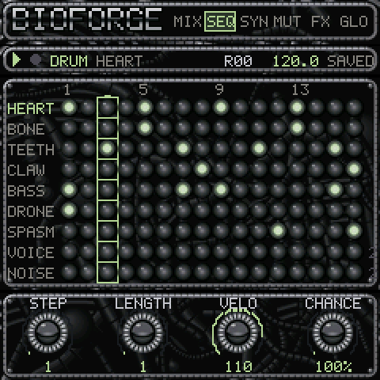
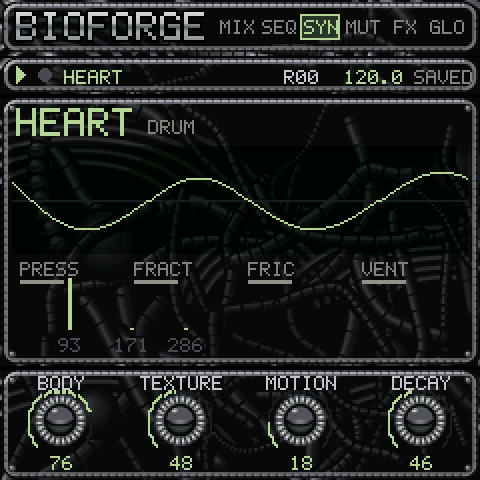
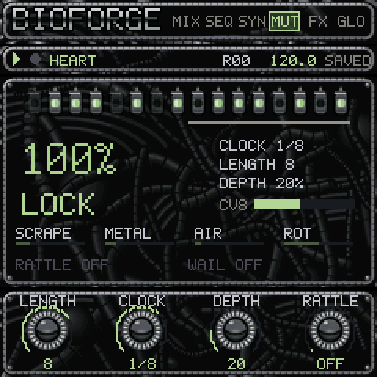
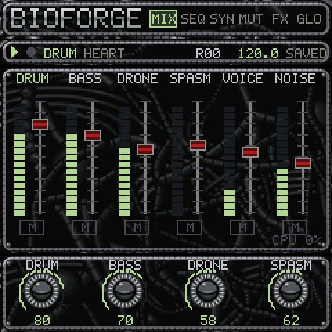
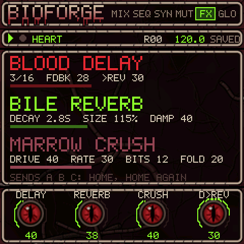

# BIOFORGE for the M-VAVE FM-1

**A biomechanical rhythm machine and synth that sounds like its own disturbing machinery.** Rhythm comes from
pressure, fracture, friction and vents in resonant bodies. Tonal organs add mass, breath, nerve discharges and an
artificial throat. You play the keys straight into the pattern memory. A Turing register works as a nervous system:
it locks the sound and the rhythm in place, and changes them slowly.

<p align="center">
  <a href="https://joakimskurk.github.io/fm1bioforge/"><b>The page: play BIOFORGE in the browser, hear the demos, install it from there →</b></a>
</p>

<p align="center">



</p>

> [!CAUTION]
> **Not yet tried on a real FM-1.** Version 0.1, in progress. It is built and tested on every change: the host tests,
> Dinghy's platform tests, the FM-1 and SMK-37 packages with the chip's own checks, and a run in fm1-emu (the FM-1
> emulator) in CI. It has not been tried on an actual device yet. Install it at your own risk.

This is a [Dinghy 0.5](https://github.com/zvenson/dinghy) app. It comes from an idea document,
*BIOFORGE idédokument v3.0*, fitted to the FM-1: 27 keys, 14 buttons, 7 encoders, one core without an FPU and a
240 x 240 screen. [docs/bioforge/PLAN.md](docs/bioforge/PLAN.md) says what was kept and how it was fitted.
[DECISIONS.md](docs/bioforge/DECISIONS.md) says why.

## What it does

- **Nine organs on six channels.** DRUM holds HEART, BONE, TEETH and CLAW. Then BASS, DRONE, SPASM, VOICE and NOISE.
  Everything you hear is synthesised in integers: no samples.
- **TISSUE drums.** A drum organ is not a kick, snare or hat with distortion. Each hit is an excitation: a PRESSURE
  impulse, seeded FRACTURE clicks, coloured FRICTION noise and a VENT of air. It runs through damped modal resonators
  at the idea document's frequencies, then an asymmetric flesh curve.
  - **HEART** is a hydraulic piston in a wet body, with modes at 93, 171 and 286 Hz.
  - **BONE** is a brittle fracture whose resonance bends after the blow.
  - **TEETH** is a ratchet of metal teeth. The lower keys play it closed, the upper keys open.
  - **CLAW** is a gesture dragged through ribs, as long as you hold the key.
  - A shared **rib** resonator ties the four together.
- **Noise as percussion.** NOISE is a percussion voice, and any drum organ can become one (its MODEL, or the SOUND
  knob). A source (WHITE, PINK, DIGI and METAL shift-register noise, CRACKLE), grain, a resonant filter that morphs
  low-pass, band-pass and high-pass and pings at high resonance, a sweep (a zap down, a rise up), bursts (a clap), a
  click, an envelope that strikes or is held while the key is, drive, a crusher and stereo width.
  - **Sixteen sounds to start from**: TICK, HISS, METAL, DIGI SNR, CLAP, ZAP, RISE, CRUSH, CRACKLE, GRAIN, PING,
    THUMP, WASH, FLAM SNR, BIT HAT and LASER. SOUND (ENV, SHIFT, KNOB 1 on a drum) gives one to an organ; TISSUE gives
    a drum its own body back.
- **PUMP.** HEART ducks the other channels, a side-chain from the kick, back by the next eighth (MIX's sends,
  SHIFT, KNOB 2).
- **Four macros an organ.** BODY, TEXTURE, MOTION and DECAY are on the first page. The depth is behind them.
- **The keys go into the memory.**
  - **LIVE REC**: press PLAY, then REC, and play.
  - **STEP REC**: stopped, press REC; each key writes a note at the cursor.
  - **PARAM REC**: while recording, turning a macro writes a p-lock.
  - Recording overdubs, or replaces (SHIFT + REC). Hold SHIFT on a key to erase that note.
  - SHIFT + OCT−/OCT+ undo and redo, 16 levels.
  - Quantise is non-destructive: a live note keeps the moment you played it, and the track's quantise places it
    when it plays.
- **The nervous system.** A 16-bit shift register, clocked from the transport. **ALGORITHM is its LOOP on every
  page**:
  - at 100 % it is locked: it repeats every LENGTH clocks;
  - at 0 % it is double-locked: the pattern, then its inverse;
  - between, it slips.
  - It moves the texture, CLAW's scrape, TEETH's metal and HEART's air (ROT and the routes).
  - It adds ghost hits on TEETH and CLAW (RATTLE) and can pick SPASM's and VOICE's notes from D Phrygian (WAIL).
  - It never moves or deletes what you played. FUSE writes its ghosts into the pattern, if you ask for it.
- **Effects.** BLOOD DELAY (synced, darker on each echo, ping-pong), BILE REVERB (four modulated delay lines, a
  FREEZE) and MARROW CRUSH (a parallel drive, sample-rate and bit crusher). Each channel has its own sends.
- **Four scenes in RAM**, each its own world at first:
  - RITUAL 00 THE AWAKENING, the idea document's start scene;
  - 01 STATIC CULT, 132 BPM, noise as percussion, with PUMP;
  - 02 SPLICE, 100 BPM, broken and glitched, ratchets and chances, a 12-step hat against 32 steps;
  - 03 VOID, 70 BPM, slow and wide, held noise washes, crackle and a long reverb.
  - PRESETS switches between them on the next bar. **SHIFT + PRESETS loads a factory ritual** into the scene that
    plays (those four, INFECTION, EMPTY BODY); the one in flash stays until you SAVE.
  - Each scene is saved in two flash slots, so a save cut off by a power cut leaves the last good one.

## Using it

| Control | What it does |
|---|---|
| **SELECT** | The focus: DRUM (the kit), or one organ (HEART … NOISE). The keys play it; REC writes to it. |
| **SEL** (SELECT pushed) | SHIFT while held. A tap keeps the knobs' second row. |
| **ALGORITHM** | The Turing's LOOP, from chaos to lock, on every page. |
| **PRESETS** | The scene, RITUAL 00..03 (playing: on the next bar). SHIFT: a factory ritual into this scene. |
| **KNOB 1..4** | The page's four parameters (SHIFT: the second four). |
| **HOME** | MIX: the six channels' levels; again: the focused channel's sends. **Held:** white keys 1–6 mute the channels. |
| **SEQ** | SEQ: the grid. **Held:** the white keys are the focused track's 16 steps: tap to set or clear; hold one and turn a knob for a p-lock; OCT± for the next 16. |
| **EDIT** | SYN: BODY TEXTURE MOTION DECAY; again: the organ's own depth. |
| **ENV** | The organ's envelope (drums: the gesture, tune, level, pan; SHIFT: SOUND, and a noise sound's GATE, WIDTH, RELEASE). |
| **LFO** | MUT: the spine. **Held:** white keys WRITE 0, WRITE 1, RESET, FUSE, LOCK. |
| **FX** | Delay, reverb, crush; again: their times and colours. |
| **GLO** | Tempo, swing, quantise and its strength; SHIFT: OVERDUB or REPLACE, the step length, the key LEDs, the MIDI channel. |
| **ARP** | **Held:** BURST on the white keys: STUTTER, INVERT (the register), FREEZE (the reverb), SPASM (a nerve burst). |
| **SAVE** | The scene to flash (playing: when it stops). SHIFT: every edited scene. Left alone, stopped and quiet, a scene saves itself. |
| **PLAY** | Start, stop. SHIFT + PLAY: PANIC (every voice silent, the memory kept). |
| **REC** | Playing: LIVE REC on and off. Stopped: STEP REC. REC held + PLAY: record from the start. |
| **OCT− / OCT+** | The keys' octave. SHIFT: UNDO, REDO. |
| **MIDI in** | Notes on channel 1 go to the focus, channels 2–10 to HEART … NOISE; they record as the keys do. Start and stop follow. |

**From nothing to a loop.** Turn SELECT to BASS. Press PLAY, then REC, and play four notes over a bar. Press REC
again: the phrase loops. Turn SELECT to TEETH and play metal hits on the keys. Turn TEXTURE (EDIT, KNOB 2) and the
LOOP (ALGORITHM) until the texture phrase is right, then turn LOOP fully up: LOCK. Press SAVE.

**Correcting a step.** Press PLAY to stop, select BASS, press REC (STEP REC). Turn KNOB 1 to step 7 and play E♭1; it
goes in with the step length and the cursor moves on. Turn KNOB 1 back to it: KNOB 2 sets its length. Press PLAY: it plays with
the drums, and the live notes keep their timing, because quantise only places them.

**The kit** (focus DRUM): four zones of about seven keys each. HEART is F3–B3, BONE C4–F#4, TEETH G4–C#5 and CLAW
D5–G5. The middle key of each zone, which glows, plays the organ as it is set; the others tune its body up or down.

<p align="center">

REV">
</p>

## Install and try

**Try it without an FM-1:** *Play it here* on [the page](https://joakimskurk.github.io/fm1bioforge/#play), in any
recent browser, phones too: the firmware itself compiled to WebAssembly, its sound, its screen and its keys' lights.
The page also has eight demos, each the firmware played by a script (`tests/scripts/demo_*.txt`).

**Install it from the browser:** [the page's installer](https://joakimskurk.github.io/fm1bioforge/#install), in Chrome
or Edge on a computer, the FM-1 on USB. It always offers the latest build of `main` that passed its tests.

**Or install it** from a computer with Python, the FM-1 on USB:

```sh
python3 tools/fm1_install.py build/bioforge.fwsc     # asks before it writes, then restarts into BIOFORGE
```

If anything goes wrong, hold **OCT−** while switching the FM-1 on. It starts in the USB rescue, where an installer
always works. Installing firmware is at your own risk.

**Build and test:**

```sh
make test     # the engine's and the memory's tests (plain and ASan/UBSan), the renders: build/audio/*.wav and their spectrograms
make host     # the app on a computer: a tour of its pages, build/host/bioforge.wav and screenshots
make perf     # the engine's instructions a frame (callgrind): the awakening, and everything at once
make fw       # the FM-1 and SMK-37 packages (the JieLi toolchain and the AC79 SDK: docs/DINGHY_README.md)
make web      # the page: the demos, BIOFORGE for the browser (clang, lld), its check in Node, build/site/ (ffmpeg)
```

## How it is made

- **[The plan](docs/bioforge/PLAN.md)** covers the organs with the idea document's numbers, the sequencer and its
  recording, the nervous system, the screens, what is cut or comes later, and the budget.
- **The engine** is `firmware/src/bio_dsp.h`, `bio_organs.h` and `bio_engine.h`. It uses integers only, the
  magic-circle modes, TPT filters, the effects at half rate where it can, and organs that fall asleep when they have
  rung out. Every hit's noise comes from a seed, so the same start gives the same sound, sample for sample.
- **The memory** is `bio_seq.h` (scenes, tracks, events, recording, undo) and `bio_turing.h` (the register).
- **The screens** come from `bio_ui.h` and `firmware/gen/bio_art.h`. The art is drawn by `tools/gen_art.py` from
  shapes and numbers: tissue, bone frames, eye knobs, membrane cells, vertebrae and a 5 x 7 font.
- **Its cost on a computer** (`make perf`, built `-Os`) is about 2 400 instructions a frame for the awakening and
  2 900 with every organ sounding and every effect on. Over 75 % of the audio interrupt, the drums out of focus ring
  on two modes instead of four.

## Platform, licence and credits

- **Platform.** Dinghy 0.5 (zvenson), imported as source and left alone but for names ([PLATFORM.md](PLATFORM.md)).
  It is built on [Felucca](https://github.com/hugelton/Felucca) by Leo Kuroshita (Hügelton Instruments) and carried
  by [SLOOP](https://github.com/isod89/sloop-fm1) (isod89), with the SMK-37 layer by genkigenki. The package's
  identity is `FM-1_908XY` (`90800` a dev build).
- **The nervous system** follows the documented behaviour of the
  [Turing Machine](https://www.musicthing.co.uk/Turing-Machine/) by Tom Whitwell (Music Thing Modular): its LOOP,
  LENGTH, WRITE and the eight-bit output. No code of it is used.
- **Licence.** GPL-3.0 ([LICENSE](LICENSE); who made what: [LICENSING.md](LICENSING.md)).
- **Trademarks.** "M-VAVE", "FM-1" and "SMK-37" belong to their owners. This is a fan project, not an official M-VAVE
  product.
